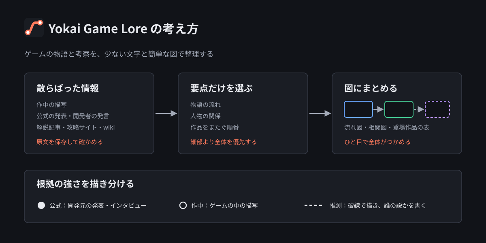
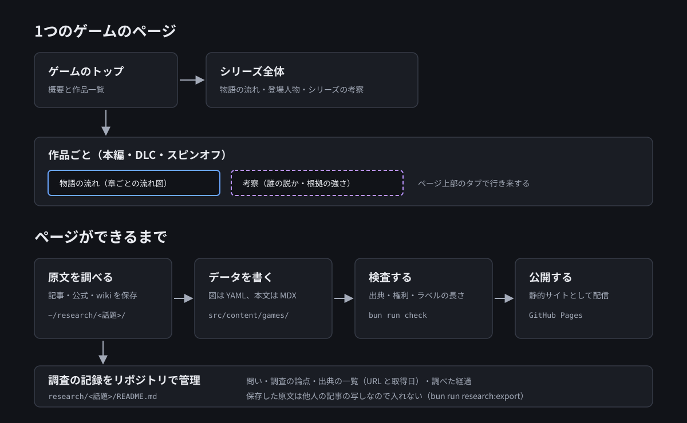

# Yokai Game Lore

ゲームの物語と考察を、少ない文字と簡単な図で整理するサイトです。

- サイト: https://ystk-kai.github.io/yokai-game-lore/
- 収録しているゲーム
  - [REANIMAL](https://ystk-kai.github.io/yokai-game-lore/games/reanimal/)（本編と DLC）
  - [スプラトゥーン](https://ystk-kai.github.io/yokai-game-lore/games/splatoon/)（1・2・3 のヒーローモード、オクト・エキスパンション、サイド・オーダー、レイダース）
  - [リトルナイトメア](https://ystk-kai.github.io/yokai-game-lore/games/little-nightmares/)（1・2・3 と DLC、ベリーリトルナイトメア、VR 版）



## 考え方

ゲームの物語は、作中のあちこちに散らばっていたり、作品をまたいで続いていたりします。解説記事や wiki は詳しい反面、読み終えるまでに時間がかかります。このサイトでは、物語の流れと人物の関係に要点を絞って図にまとめ、図を見れば全体をつかめるようにします。

- **情報を絞る**: 細部よりも、物語の流れと人物の関係を優先します
- **事実と推測を分ける**: 物語のページには作中の描写と公式の情報だけを書き、推測は考察のページに分けます。推測には誰の説かを書き添えます
- **根拠の強さを描き分ける**: どの図でも、公式（●）・作中（○）・推測（破線）の3段階で描き分けます
- **出典を示す**: 事実には出典へのリンクを付けます

図の読み方は、サイトの [図の読み方](https://ystk-kai.github.io/yokai-game-lore/guide/) に架空のゲームの例で載せています。

## サイトの作り



ゲームごとに、シリーズ全体のページ（物語の流れ・登場人物・シリーズの考察）と、作品ごとのページ（物語の流れ・考察）があります。作品ごとのページは、ゲームのトップの作品一覧とサイドメニューから開けます。

ページは次の順で作ります。

1. 原文を調べる: 記事・公式の発表・wiki を手元の `~/research/<話題>/` に保存し、書く内容を原文で確かめます（リポジトリには含めません）
2. データを書く: 図は `src/content/games/<ゲーム>/diagrams/*.yaml`、本文は `pages/*.mdx` に書きます
3. 検査する: `bun run check` で、出典・権利の記載・図のラベルの長さ・型・ビルドを確かめます
4. 公開する: GitHub Pages に静的サイトとして出します

## 開発

[Bun](https://bun.sh/) と [Astro](https://astro.build/) で作った静的サイトです。

```sh
bun install
bun run dev     # http://localhost:4321/yokai-game-lore/
bun run check   # コンテンツ検査 → 型検査 → ビルド
```

ゲームの追加やページの書き方は [AGENTS.md](AGENTS.md)、見た目の規約は [DESIGN.md](DESIGN.md) にあります。

## 権利

- このサイトは、各ゲームの権利者の運営・承認・後援を受けていません。ゲームの名称・内容・画像の権利は各権利者に帰属します
- 画像は、キャラクターの見た目など説明に要るものだけを、小さく、出典つきで載せています。ファンサイトでの掲載を認める規約が無いゲームでは、運営者の判断で載せています。根拠はゲームごとに `game.yaml` の `rights` に書いています。権利者から求められた場合は速やかに削除します
- 画像とアイコンの出典は、サイトの [クレジット](https://ystk-kai.github.io/yokai-game-lore/credits/) にまとめています。アイコンは [game-icons.net](https://game-icons.net/)（CC BY 3.0、Lorc・Delapouite ほか）と [Lucide](https://lucide.dev/)（ISC）です
- このリポジトリのコードは MIT License、サイトの文章（考察本文）は CC BY 4.0 です
